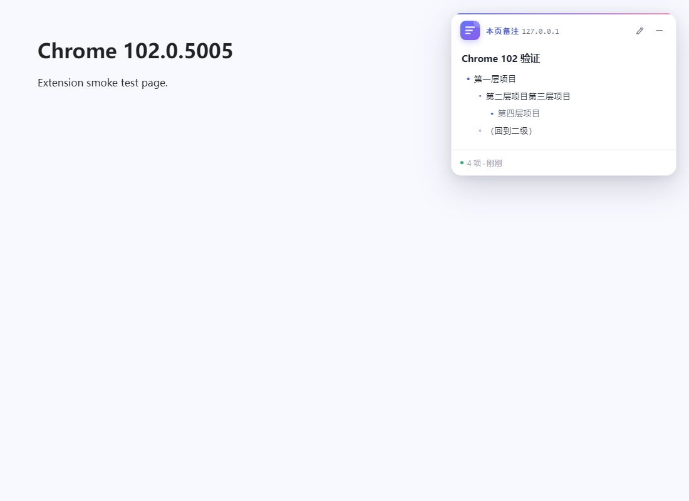
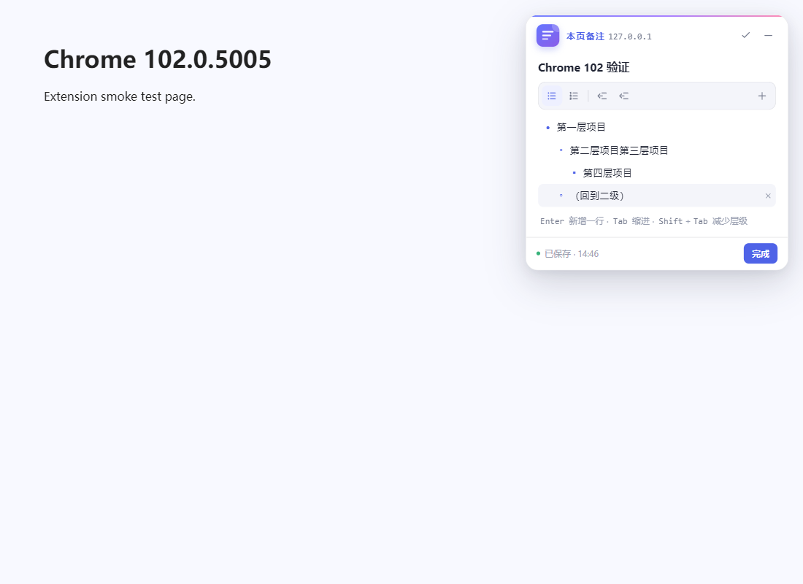
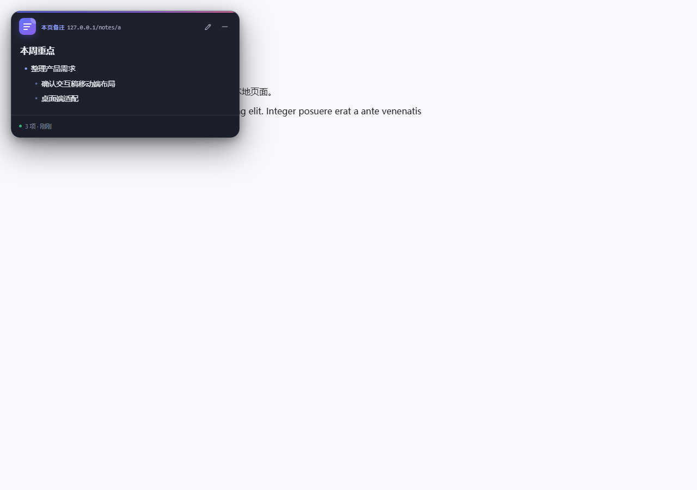
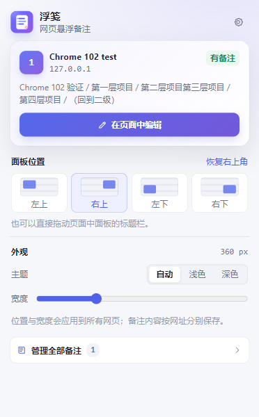

# 浮笺 · 网页悬浮备注

一个面向 **Chrome 102.0.5005.200** 的本地 Chrome 扩展（Manifest V3）。它会在网页上显示一个可拖动的悬浮备注窗口，用多级列表记录这一页的重点，并按网址自动保存、自动切换。悬浮栏默认隐藏，点击工具栏中的浮笺图标后显示。

> **AI 生成声明**：本项目的扩展源码、界面样式、图标、测试脚本和文档均由 AI 编码助手（DeepSeek Harness）根据需求生成，并在此基础上迭代维护。使用或分发前请自行审查代码。



## 功能

- **默认隐藏**：打开网页时不显示悬浮栏；点击工具栏中的浮笺图标后才展示，避免遮挡页面。
- **网页悬浮窗**：默认停在页面右上角，不随页面滚动；可以收起为标题条，也可以点击关闭按钮隐藏。
- **用户自定义位置**：工具栏弹窗里可选左上 / 右上 / 左下 / 右下，或直接拖动面板标题栏自由摆放；位置会应用到所有网页。
- **多级列表**：支持项目符号列表、编号列表、最多 5 级缩进；`Tab` 缩进、`Shift + Tab` 减少层级。
- **一级折叠**：一级条目下有多级子项时，可一键收起整段，只保留一级标题，方便在长备注中快速浏览。
- **按网址保存**：每个网址一份独立备注，刷新、跳转、重新打开页面后自动恢复。
- **自动保存**：编辑停顿约 0.5 秒后写入本地存储，底部显示保存状态与时间。
- **外观设置**：浅色 / 深色 / 跟随系统，面板宽度 300–520 px。
- **备注库**：设置页集中搜索、打开、删除所有备注。
- **备份迁移**：导出 / 导入 JSON 备份，导入时按网址合并。
- **隐私友好**：没有账号、没有服务器、没有统计或远程请求，数据只在本机。

| 编辑多级列表 | 深色模式 |
| --- | --- |
|  |  |

| 工具栏弹窗 | 设置与备注库 |
| --- | --- |
|  |  |

## 安装（Chrome 102）

1. 下载并解压本扩展，得到包含 `manifest.json` 的文件夹。
2. 在 Chrome 地址栏打开 `chrome://extensions/`。
3. 打开右上角的 **开发者模式**。
4. 点击 **加载已解压的扩展程序**，选择该文件夹。
5. 把“浮笺”固定到工具栏；**已经打开的网页需要刷新一次**。刷新后悬浮栏默认不显示，点击工具栏中的浮笺图标即可显示。

> 如果通过“加载已解压的扩展程序”安装，请不要删除源文件夹，Chrome 会直接从该文件夹运行扩展。

在 Chrome 102 中，扩展默认不会注入浏览器内部页面（`chrome://...`）、Chrome 应用商店页面和部分 PDF 查看器页面，这是浏览器的安全限制。

### 使用本地文件网页

如果要给 `file://` 页面添加备注，请进入扩展详情，打开 **允许访问文件网址**，然后刷新该文件页面。

## 使用

### 记录备注

1. 打开任意普通网页。悬浮栏默认关闭，不会自动出现。
2. 点击工具栏中的浮笺图标。弹窗打开的同时，悬浮栏会显示在页面右上角。
3. 在悬浮栏中点击 **开始记录**，或面板右上角的铅笔按钮。
4. 可选填写标题，在列表中逐行输入内容。
5. 点击 **完成** 回到阅读视图。

面板为空时会显示引导；已经有备注时，可以直接阅读多级列表。双击备注正文也可以进入编辑。

### 多级列表操作

| 操作 | 方式 |
| --- | --- |
| 新增一行 | 在列表行内按 `Enter`，或点击工具栏 `+` |
| 增加缩进 | 在行内按 `Tab`，或点击工具栏缩进按钮 |
| 减少缩进 | 按 `Shift + Tab`，或点击工具栏减少缩进按钮 |
| 切换项目符号 / 编号列表 | 工具栏前两个按钮；编号列表按层级显示 `1.` / `a.` / `i.` |
| 删除一行 | 鼠标悬停在该行，点击右侧 `×` |
| 结束编辑 | 点击 **完成**，或在行内按 `Esc` |
| 上下移动焦点 | 在行首 / 行尾按 `↑` / `↓` |

把多行文本粘贴进列表时，扩展会按每行开头的空格数自动生成层级（约两个空格一级），并去掉常见的 `-`、`*`、`1.` 等列表符号。

### 折叠一级列表

- 一级条目如果包含子项，右侧会显示「子项数量 + 展开箭头」。
- 点击后收起该一级条目下的所有层级，只保留当前一级标题；再次点击展开。
- 折叠只改变阅读视图，不修改或删除备注内容。
- 折叠状态在当前页面会话中保留：关闭悬浮栏再打开，或在单页应用内切换到其他网址再返回，仍会保持。
- 进入编辑并点击 **完成** 后会自动展开全部内容，便于查看刚修改的部分；刷新页面后也会恢复为全部展开。

### 每个网址的备注

备注按规范化后的网址保存：

- 同一网址刷新、前进后退、重新打开，备注都会恢复。
- 页面内的 `#锚点` 不会创建新备注（例如 `/docs#install` 和 `/docs` 共用备注）。
- 查询参数会保留，因此 `/search?q=a` 和 `/search?q=b` 被视为两个网址，各自拥有备注。
- 这是“精确到网址”的备注，不是“整个网站共享”的备注。

### 移动、收起与关闭

- 按住面板标题栏（左侧图标和网址区域）拖动即可改变位置。
- 拖动后位置会被记住；在工具栏弹窗中选择任意角落，可以重新停靠。
- 点击标题栏右侧的 `—` 收起为标题条，再点一次展开。
- 点击标题栏最右侧的关闭按钮（`×`）隐藏悬浮栏；再次点击工具栏中的浮笺图标即可重新显示。
- 关闭时如果正在编辑，会先保存当前内容再隐藏；保存失败时会保留悬浮栏并提示重试。
- 打开工具栏弹窗会自动显示悬浮栏，点击 **显示并编辑备注** 可直接进入编辑状态。

### 工具栏弹窗

- 点击工具栏图标时，当前页面的悬浮栏会自动显示。
- 显示当前页面标题、网址以及是否已有备注。
- **显示并编辑备注**：确保悬浮栏显示，并进入编辑状态。
- **面板位置**：四个角落预设，或恢复右上角。
- **主题 / 宽度**：立即联动当前打开的页面。
- **管理全部备注**：进入设置页。

### 设置页

- 搜索标题、网址或备注正文。
- 查看每条备注的层级预览、列表项数量和更新时间。
- 打开对应页面，或删除单条备注。
- 导出全部数据为 JSON；导入时与现有备注合并，相同网址以导入文件为准。
- 删除全部备注（外观设置保留）。

## 数据与权限

### 存储位置

数据保存在扩展的 `chrome.storage.local` 中：

- `floatnote.settings.v1`：位置、宽度、主题。
- `floatnote.notes.v1`：以规范化网址为键的备注对象。

扩展不会发起任何网络请求。卸载扩展或在设置页删除备注后，数据会从本机移除；需要保留时请先导出备份。

### 权限说明

| 权限 | 用途 |
| --- | --- |
| `storage` | 保存设置与按网址区分的备注 |
| `<all_urls>` | 在普通网页中显示悬浮面板 |
| `activeTab` | 工具栏弹窗读取当前标签页并打开面板 |
| `scripting` | 扩展更新后，对已经打开的页面补注入内容脚本 |

Chrome 会把 `<all_urls>` 显示为“读取和更改您在所有网站上的数据”。扩展只读取当前网址用于匹配备注，不抓取、不上传页面内容。

## 兼容性

- `manifest.json` 设置了 `"minimum_chrome_version": "102"`，按 Chrome 102 的 Manifest V3、回调式 `chrome.storage` API 和 CSS 能力实现。
- Chrome 102 兼容性已在 1.0.0 版本上完成实机验证；1.0.1 和 1.0.2 只调整悬浮栏显隐、关闭按钮与一级列表折叠，没有使用任何新增浏览器 API。
- 也在较新的 Chromium 上验证了拖拽定位、宽度同步、主题联动、弹窗打开编辑、导入 / 导出 / 清空。
- Chrome 102.0.5005.200 是该版本线的后续补丁版本，使用的 API 与上面的测试版本一致。
- 不支持 Chrome 内置页面、Chrome 应用商店页面；这些页面由浏览器禁止注入脚本。

## 文件结构

```text
chrome-note/
├─ manifest.json
├─ icons/
│  ├─ icon16.png
│  ├─ icon32.png
│  ├─ icon48.png
│  └─ icon128.png
├─ src/
│  ├─ background.js     # 首次安装写入默认设置
│  ├─ shared.js         # 数据模型、存储、URL 规范化
│  ├─ content.js        # Shadow DOM 悬浮面板与列表编辑器
│  ├─ popup.html/css/js # 工具栏弹窗
│  └─ options.html/css/js
├─ docs/                # README 截图
├─ tools/               # 图标生成与本地自动化测试脚本
└─ README.md
```

扩展没有构建步骤，修改源码后在本机 `chrome://extensions/` 点击扩展卡片上的刷新按钮即可。内容脚本更新后，已有页面仍需刷新。

## 开发与测试

- 纯原生 JavaScript、HTML、CSS，无运行时依赖，无网络字体或第三方脚本。
- 悬浮面板使用 Shadow DOM 隔离页面样式，并用固定定位避免页面布局影响。
- 本地测试使用 Playwright + Chromium；源码仓库中的 `tools/test-102.js` 用于 Chromium 102 可见窗口回归，`tools/test-extension.js` 用于新版本 Chromium 的完整交互测试。测试脚本与浏览器文件不包含在发布包内，也不参与扩展运行。

## 已知限制

- 每个网址只保存一份备注，不支持同一网址多张便签。
- 只支持标题和纯文本列表，不支持图片、表格、Markdown 渲染。
- 不提供云同步或跨设备同步；请使用导出备份迁移。
- 面板位置和宽度是全局设置；备注内容按网址独立。
- 同一备注在多个标签页同时编辑时，以最后一次保存为准。
- 浏览器内置页面、应用商店和受保护页面无法显示面板。
- 单条备注最多 500 行、每行最多 2000 字，标题最多 120 字。

## AI 生成说明

本项目是一个 AI 生成并持续迭代的代码项目：

- 扩展功能设计、源代码、CSS、图标、README、测试脚本均由 AI 编码助手（DeepSeek Harness）根据对话需求生成。
- 用户提出修改要求后，AI 直接编辑代码并重新打包；Git 提交用于记录这些变更。
- AI 生成内容可能存在遗漏或错误，使用、分发或二次开发前请自行进行代码审查与安全评估。

## 版本

- **1.0.2**：一级列表支持折叠/展开，新增 AI 生成说明。
- **1.0.1**：悬浮栏改为默认隐藏，点击工具栏图标显示；标题栏新增关闭按钮；关闭正在编辑的备注前会先保存。
- **1.0.0**：首个版本。悬浮备注、多级列表、按网址存储、位置 / 宽度 / 主题设置、备注库、导入导出。
